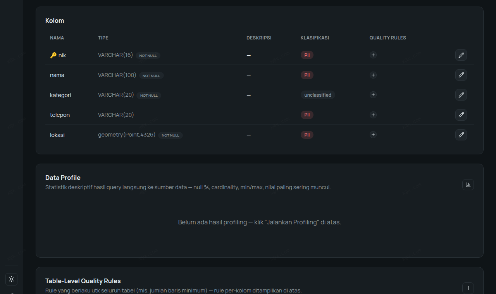
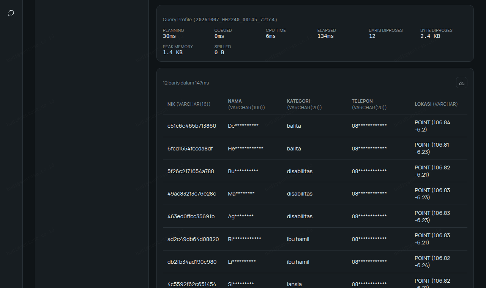
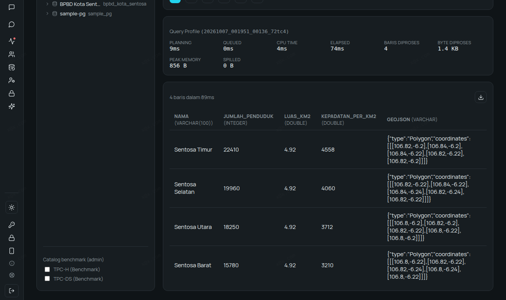
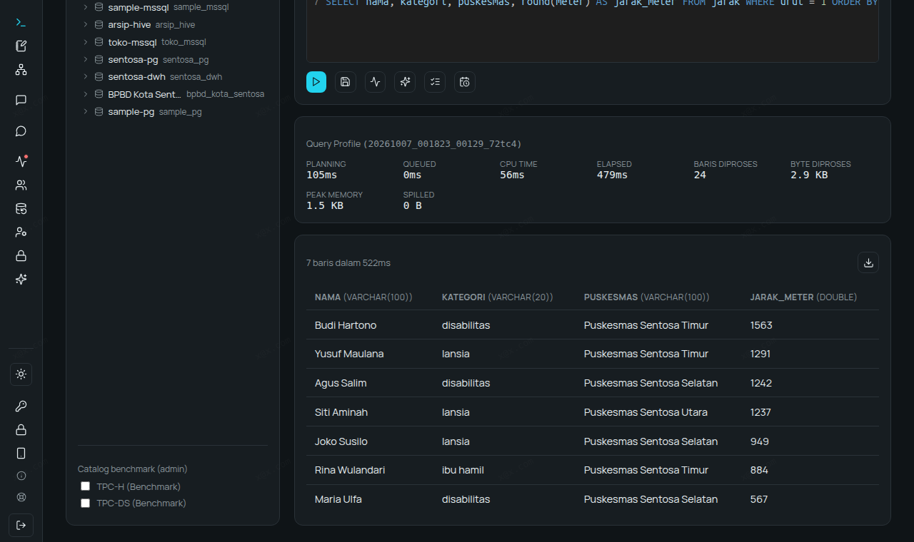
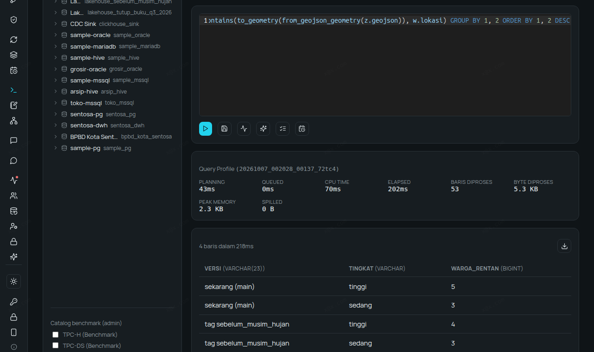
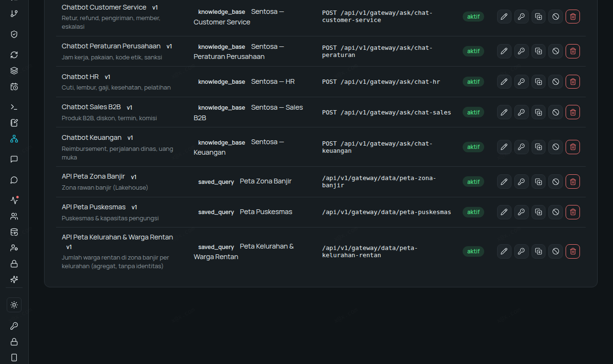
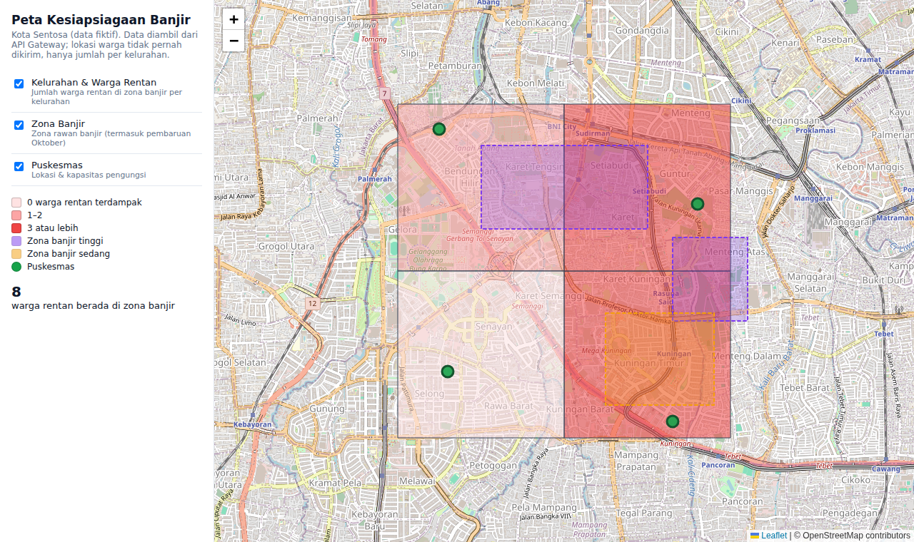
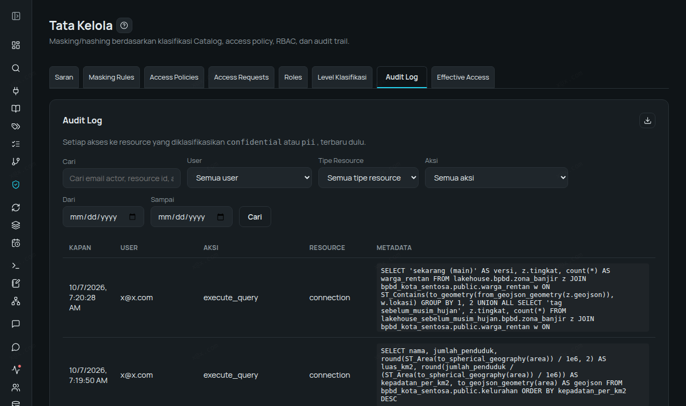

# Walkthrough — Flood-Preparedness Map: GIS Data from PostGIS to a Map, with Residents' Locations Kept Private

**Language:** [Bahasa Indonesia](README.md) · English

Enterprise Data Platform reads map data from PostGIS, analyses it with spatial SQL, stores it in the
Lakehouse as versioned GeoJSON, and serves it to a map application through an API — while treating
residents' locations as personal data (Indonesia's Personal Data Protection Law, UU PDP). Every
number, query, and screenshot below comes from a real run, not a made-up example. The data is
entirely fictional.

> The sample database, SQL, and screenshots use Indonesian names (e.g. `kelurahan` = urban village /
> district, `zona_banjir` = flood zone, `puskesmas` = community health center, `warga_rentan` =
> vulnerable residents). They are kept as-is so you can run the queries exactly as shown.

## Scenario

**BPBD Kota Sentosa** (the fictional disaster management agency of Sentosa City) is preparing for the
rainy season. Its PostGIS database contains:

| Table | Contents | Map column |
|---|---|---|
| `kelurahan` | 4 districts + population | `area` — `geometry(Polygon,4326)` |
| `zona_banjir` | high- and medium-risk flood zones | `area` — `geometry(Polygon,4326)` |
| `puskesmas` | 4 community health centers + evacuee capacity | `lokasi` — `geography(Point,4326)` |
| `warga_rentan` | 12 residents (elderly, disabled, pregnant, toddlers): national ID (NIK), name, phone | `lokasi` — `geometry(Point,4326)` |

The agency's questions: *which vulnerable residents live inside a flood zone, which nearest health
center has to get ready, and how can the map be shared with other agencies without leaking
residents' addresses?*

Roles: **admin/steward** (sees the real data) and **Budi**, an analyst (role *Data Analyst*).

Requires Enterprise Data Platform **version 1.36 or later** (`geography` columns and masking of map
columns).

## Step 0 — Prepare the PostGIS Database (2 minutes)

**Option A — sample data (platform installed on Kubernetes).** One command seeds the Sentosa City data:

```bash
curl -fsSL https://get.alzizan.co.id/sample-data | bash -s -- --services postgis
```

Connection details: host `sample-postgis.sample-data.svc.cluster.local`, port `5432`, database
`sentosa`, user/password `sample`/`sample`.

**Option B — Docker (on any machine the platform can reach):**

```bash
docker run -d --name sentosa-gis -p 5432:5432 -e POSTGRES_PASSWORD=<password> postgis/postgis:18-3.6-alpine
docker exec sentosa-gis psql -U postgres -c "CREATE DATABASE sentosa"
docker exec -i sentosa-gis psql -U postgres -d sentosa < data/seed-kota-sentosa.sql
```

Connection details: host = that Docker machine's address, port `5432`, database `sentosa`, user `postgres`.

## Step 1 — Connect & Scan: Map Types Read Intact

**Connections → New Connection** (PostgreSQL, database `sentosa`) → **Scan**: 5 tables detected. The
Data Catalog shows the original types of the map columns — `geometry(Point,4326)`,
`geography(Point,4326)`, `geometry(Polygon,4326)` — including their coordinate system.

The steward tags `nik`, `nama` (name), `telepon` (phone), and `lokasi` (location) in `warga_rentan` as
**PII**, and the table itself as **PII** too (so every query against it is recorded in the Audit Log).



## Step 2 — Protect Residents' Locations (UU PDP)

**Governance → Masking Rules**: `nik` = hash, `nama`/`telepon`/`lokasi` = mask. The same query:

| | NIK | Name | Phone | Location |
|---|---|---|---|---|
| Admin | 3171010101500001 | Siti Aminah | 0812-1111-0001 | POINT (106.815 -6.208) |
| Budi (analyst) | 4c5592f62c651454 | Si********* | 08************ | POINT (106.82 -6.21) |

For map columns, masking **blurs** the location to a point rounded to about ±1.1 km: Budi can still
analyse the distribution, but cannot find anyone's house.



**Honest note**: because the locations are blurred, Budi's counts become **estimates**. The query "how
many vulnerable residents are in a flood zone" returns **5** for Budi, while the real number is **7**
(points near a zone boundary shift). For official numbers, use the summary-table pattern in Step 5.

## Step 3 — Spatial Analysis in the SQL Workspace

All queries below are run by the admin/steward; each finishes in **0.1–0.5 seconds**.

**Area, density, and GeoJSON per district** — area is computed on the Earth's surface (km²):

```sql
SELECT nama, jumlah_penduduk,
       round(ST_Area(to_spherical_geography(area)) / 1e6, 2) AS luas_km2,
       round(jumlah_penduduk / (ST_Area(to_spherical_geography(area)) / 1e6)) AS kepadatan_per_km2,
       to_geojson_geometry(area) AS geojson
FROM bpbd_kota_sentosa.public.kelurahan
ORDER BY kepadatan_per_km2 DESC;
```

Result: Sentosa Timur is the densest (4,558 people/km², area 4.92 km²).



**Who is affected?** Residents' points inside the flood-zone polygons (`ST_Contains`), together with
their district: **4 residents in the high-risk zone** (Bantaran Kali Sentosa) and **3 in the
medium-risk zone** (Cekungan Pasar Lama).

**Nearest health center for each affected resident** — distance in meters on the Earth's surface; the
`geography` column is read with `ST_GeomFromBinary(from_hex(...))`:

```sql
WITH jarak AS (
  SELECT w.nama, w.kategori, p.nama AS puskesmas,
         ST_Distance(to_spherical_geography(w.lokasi),
                     to_spherical_geography(ST_GeomFromBinary(from_hex(p.lokasi)))) AS meter,
         row_number() OVER (PARTITION BY w.nik ORDER BY ST_Distance(
           to_spherical_geography(w.lokasi),
           to_spherical_geography(ST_GeomFromBinary(from_hex(p.lokasi))))) AS urut
  FROM bpbd_kota_sentosa.public.warga_rentan w
  CROSS JOIN bpbd_kota_sentosa.public.puskesmas p
  WHERE EXISTS (SELECT 1 FROM bpbd_kota_sentosa.public.zona_banjir z WHERE ST_Contains(z.area, w.lokasi)))
SELECT nama, kategori, puskesmas, round(meter) AS jarak_meter
FROM jarak WHERE urut = 1 ORDER BY jarak_meter DESC;
```

Result: Budi Hartono (disabled) is the farthest — 1,563 m from Puskesmas Sentosa Timur; Maria Ulfa is
the closest — 567 m. Field staff know who needs to be picked up first.



**Also run**:
- Vulnerable residents within 1 km of each health center (`ST_Distance(...) <= 1000`): Timur 2,
  Selatan 2, Barat 1, Utara 0.
- Switching the coordinate system to Web Mercator for web maps:
  `ST_Transform(ST_GeomFromEWKT('SRID=4326;POINT (...)'), 3857)`.

## Step 4 — Lakehouse: Store as GeoJSON + a "Before the Rainy Season" Version

```sql
CREATE SCHEMA lakehouse.bpbd;
CREATE TABLE lakehouse.bpbd.zona_banjir AS
  SELECT id, tingkat, keterangan, to_geojson_geometry(area) AS geojson
  FROM bpbd_kota_sentosa.public.zona_banjir;
-- same for kelurahan and puskesmas
```

Then **Lakehouse → Tag** `sebelum_musim_hujan` ("before the rainy season") freezes the current state.
The October update from BMKG (Indonesia's meteorology agency) adds a new zone, *Luapan Kali Timur*, on
main. One query compares the two (GeoJSON in the Lakehouse joined directly with residents' points in
PostGIS):

| Version | High-risk zone | Medium-risk zone |
|---|---|---|
| current (main) | **5** vulnerable residents | 3 |
| tag `sebelum_musim_hujan` | 4 | 3 |



## Step 5 — Share the Map via the API Gateway (Without Leaking Addresses)

Three saved queries are published as APIs, each with its own API key: `peta-zona-banjir` (flood
zones), `peta-puskesmas` (health centers), and `peta-kelurahan-rentan` (vulnerable residents per
district).



**Key lesson**: the first version of `peta-kelurahan-rentan` counted affected residents directly from
`warga_rentan`. Through the API Gateway, masking always applies at its strictest, so residents'
locations were blurred too and the result was wrong (Sentosa Timur 0 instead of 3). The correct
pattern:

1. The steward (a role exempt from masking) computes a summary into the Lakehouse table
   `lakehouse.bpbd.ringkasan_kelurahan` — it contains only the district code and name, population,
   the **number** of affected vulnerable residents, and the district's GeoJSON. No NIK, names, or
   residents' points.
2. The API publishes that summary table. Result through the API: Utara 1, Timur 3, Barat 0,
   Selatan 4 — correct.

**Map page** (`peta-app/`, two files, Leaflet + OpenStreetMap): districts are colored by the number of
affected vulnerable residents, plus flood zones and health centers — all from the API Gateway. The
API keys stay on the server.

```bash
cd peta-app
cp config.example.json config.json   # fill in gateway_url + path + API key for each layer
python3 server.py                    # then open port 8766 in a browser
```



## Step 6 — Ask in Plain Language (Ask Data)

On-premise AI (Ollama `qwen3:4b`, 6 GB GPU), questions asked in Indonesian:

- *"Which district in Sentosa City is the most densely populated?"* → SQL generated, answer **Sentosa
  Timur** (correct), 30 seconds.
- *"How many vulnerable residents live inside a high-risk flood zone?"* → **failed**: the model wrote a
  wrong spatial join (`Column 'zona_banjir.area' cannot be resolved`). For spatial questions, the
  queries in Step 3 remain the reliable path; a larger model may do better.

## Step 7 — Audit Trail

Every query against the `warga_rentan` (PII) table is recorded — who, when, and the query text —
including Budi's queries and every call to the map API (`gateway_data_access`).



## Summary

| Need | Feature |
|---|---|
| Read PostGIS data as it is | Connection + Data Catalog (`geometry(...)` / `geography(...)` types intact) |
| Residents' locations are personal data | PII classification + masking: location blurred ±1.1 km, NIK hashed |
| Spatial analysis | SQL Workspace: `ST_Contains`, `ST_Distance`, `ST_Area`, `ST_Transform`, GeoJSON |
| Combine different sources | Federated query: GeoJSON in the Lakehouse × points in PostGIS |
| Versioned map data | Lakehouse + tag (`sebelum_musim_hujan`) |
| Share with other agencies | API Gateway + API key + Leaflet map page |
| Official numbers without leaking addresses | Summary table built by the steward; the API publishes aggregates only |
| Who saw what | Audit Log |

## Limitations (Honest)

- There is no map view inside the platform yet; the map in this walkthrough is a separate app that
  reads the API.
- The Lakehouse has no dedicated map column type yet (Iceberg v3 `geometry` isn't supported by the
  query engine yet); GeoJSON is stored as text.
- Blurred locations turn per-area counts into estimates (see Steps 2 and 5).
- Data profiling of `geometry` columns shows raw binary (WKB) values — no spatial statistics yet.
- Ask Data is not yet reliable for spatial questions.
- PostGIS columns copied via CDC are not yet recognised as map data.

## Files

- `data/seed-kota-sentosa.sql` — fictional Sentosa City data (PostGIS), for Option B in Step 0.
- `peta-app/` — `index.html`, `server.py`, and `config.example.json` (copy it to `config.json`).

## Try It Yourself

- Free trial, no sales call: https://alzizan.co.id/register
- Want to see it with your team's use case? Request a demo, or a free in-house *Big Data & AI Tech Update* session at your office: https://alzizan.co.id/en/demo
- Demo videos: https://www.youtube.com/@AlzizanDigitalSolutions

---

The content of this repository is licensed under [CC BY 4.0](LICENSE). © PT Alzizan Digital Solutions.
