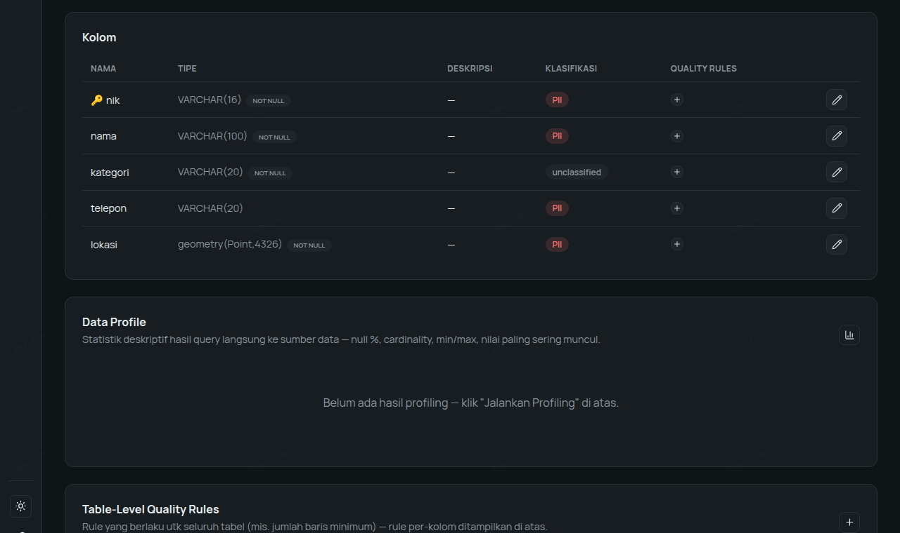
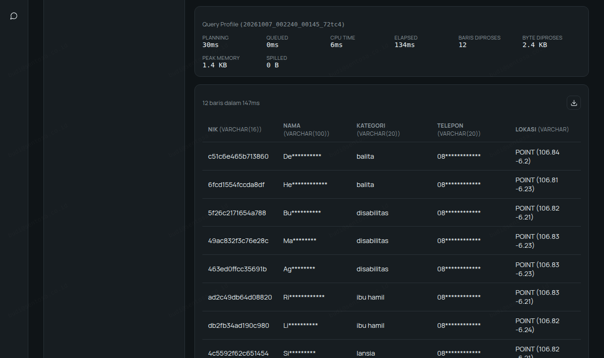
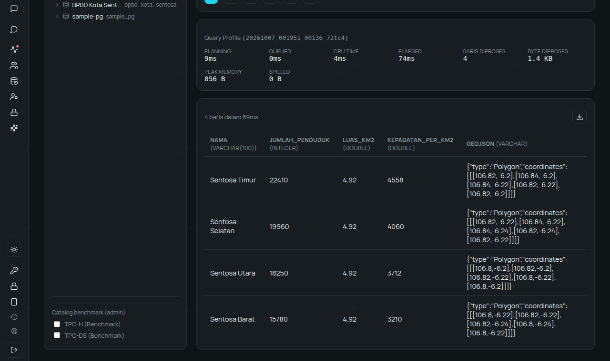
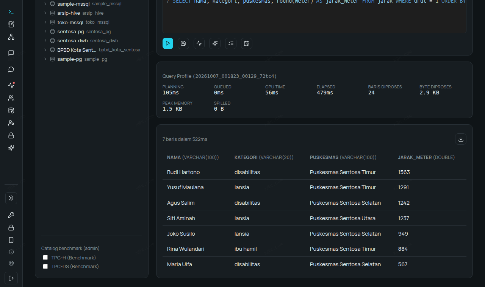
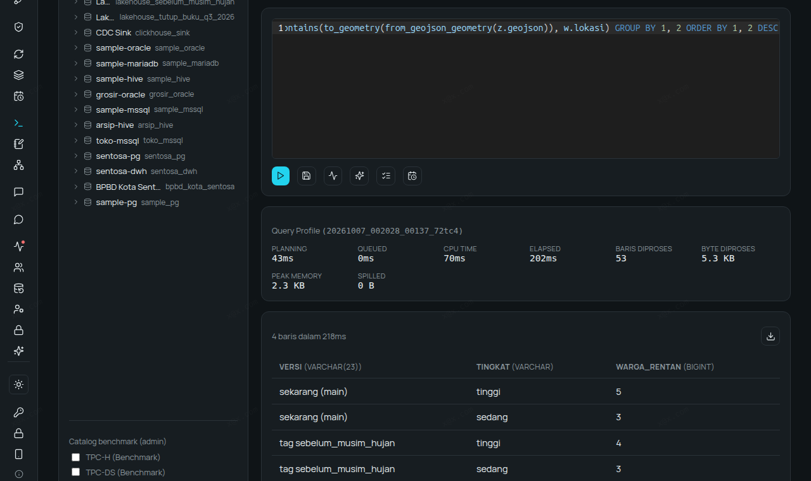
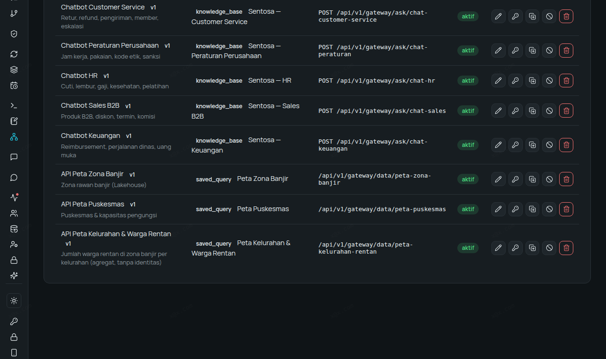
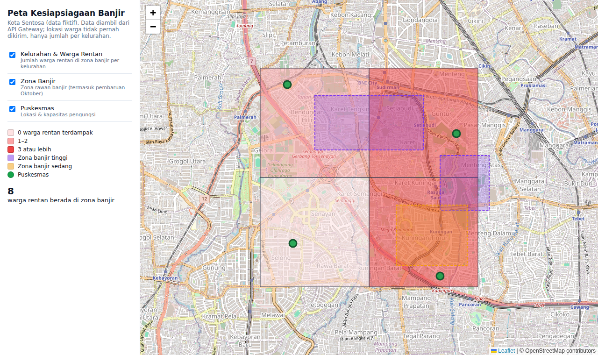
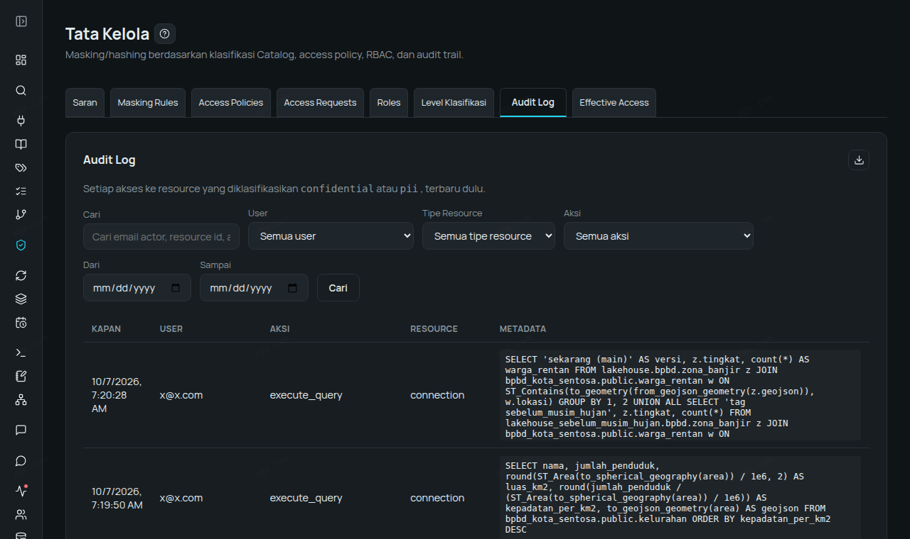

# Walkthrough — Peta Kesiapsiagaan Banjir: Data GIS dari PostGIS sampai Peta, dengan Lokasi Warga Tetap Terlindungi

Enterprise Data Platform membaca data peta dari PostGIS, menganalisisnya dengan SQL spasial,
menyimpannya di Lakehouse sebagai GeoJSON ber-versi, lalu menyajikannya ke aplikasi peta lewat API —
sambil menjaga lokasi warga sebagai data pribadi (UU PDP). Semua angka, query, dan screenshot di
bawah adalah hasil run nyata, bukan contoh karangan. Data sepenuhnya fiktif.

## Skenario

**BPBD Kota Sentosa** (fiktif) bersiap menghadapi musim hujan. Database PostGIS-nya berisi:

| Tabel | Isi | Kolom peta |
|---|---|---|
| `kelurahan` | 4 kelurahan + jumlah penduduk | `area` — `geometry(Polygon,4326)` |
| `zona_banjir` | zona rawan banjir tinggi & sedang | `area` — `geometry(Polygon,4326)` |
| `puskesmas` | 4 puskesmas + kapasitas pengungsi | `lokasi` — `geography(Point,4326)` |
| `warga_rentan` | 12 warga (lansia, disabilitas, ibu hamil, balita): NIK, nama, telepon | `lokasi` — `geometry(Point,4326)` |

Pertanyaan BPBD: *warga rentan mana yang ada di zona banjir, puskesmas terdekat mana yang harus
bersiap, dan bagaimana membagikan peta ke dinas lain tanpa membocorkan alamat warga?*

Peran: **admin/steward** (melihat data asli) dan **Budi**, analis (Role *Data Analyst*).

Dibutuhkan Enterprise Data Platform **versi 1.36 atau lebih baru** (kolom `geography` dan masking kolom
peta).

## Langkah 0 — Siapkan Database PostGIS (2 menit)

**Pilihan A — sample data (platform terpasang di Kubernetes).** Satu perintah, data Kota Sentosa
langsung ter-seed:

```bash
curl -fsSL https://get.alzizan.co.id/sample-data | bash -s -- --services postgis
```

Detail koneksi: host `sample-postgis.sample-data.svc.cluster.local`, port `5432`, database `sentosa`,
user/password `sample`/`sample`.

**Pilihan B — Docker (di mesin mana pun yang bisa dijangkau platform):**

```bash
docker run -d --name sentosa-gis -p 5432:5432 -e POSTGRES_PASSWORD=<password> postgis/postgis:18-3.6-alpine
docker exec sentosa-gis psql -U postgres -c "CREATE DATABASE sentosa"
docker exec -i sentosa-gis psql -U postgres -d sentosa < data/seed-kota-sentosa.sql
```

Detail koneksi: host = alamat mesin Docker tersebut, port `5432`, database `sentosa`, user `postgres`.

## Langkah 1 — Hubungkan & Scan: Tipe Peta Terbaca Utuh

**Connections → New Connection** (PostgreSQL, database `sentosa`) → **Scan**: 5 tabel terdeteksi.
Data Catalog menampilkan tipe asli kolom peta — `geometry(Point,4326)`, `geography(Point,4326)`,
`geometry(Polygon,4326)` — lengkap dengan sistem koordinatnya.

Steward menandai `nik`, `nama`, `telepon`, dan `lokasi` di `warga_rentan` sebagai **PII**, dan tabelnya
juga **PII** (supaya setiap query ke tabel ini tercatat di Audit Log).



## Langkah 2 — Lindungi Lokasi Warga (UU PDP)

**Governance → Masking Rules**: `nik` = hash, `nama`/`telepon`/`lokasi` = mask. Query yang sama:

| | NIK | Nama | Telepon | Lokasi |
|---|---|---|---|---|
| Admin | 3171010101500001 | Siti Aminah | 0812-1111-0001 | POINT (106.815 -6.208) |
| Budi (analis) | 4c5592f62c651454 | Si********* | 08************ | POINT (106.82 -6.21) |

Untuk kolom peta, masking **mengaburkan** lokasi ke titik yang dibulatkan ±1,1 km: Budi tetap bisa
menganalisis sebaran, tetapi tidak bisa menemukan rumah warga.



**Catatan jujur**: karena lokasinya dikaburkan, hitungan Budi menjadi **perkiraan**. Query "berapa
warga rentan di zona banjir" menghasilkan **5** untuk Budi, sedangkan angka sebenarnya **7** (titik di
dekat batas zona bergeser). Untuk angka resmi, lihat pola tabel ringkasan di Langkah 5.

## Langkah 3 — Analisis Spasial di SQL Workspace

Semua query di bawah dijalankan admin/steward; masing-masing selesai dalam **0,1–0,5 detik**.

**Luas, kepadatan, dan GeoJSON per kelurahan** — luas dihitung di permukaan bumi (km²):

```sql
SELECT nama, jumlah_penduduk,
       round(ST_Area(to_spherical_geography(area)) / 1e6, 2) AS luas_km2,
       round(jumlah_penduduk / (ST_Area(to_spherical_geography(area)) / 1e6)) AS kepadatan_per_km2,
       to_geojson_geometry(area) AS geojson
FROM bpbd_kota_sentosa.public.kelurahan
ORDER BY kepadatan_per_km2 DESC;
```

Hasil: Sentosa Timur paling padat (4.558 jiwa/km², luas 4,92 km²).



**Siapa yang terdampak?** Titik warga di dalam poligon zona banjir (`ST_Contains`), sekaligus
kelurahannya: **4 warga di zona tinggi** (Bantaran Kali Sentosa) dan **3 di zona sedang** (Cekungan
Pasar Lama).

**Puskesmas terdekat untuk tiap warga terdampak** — jarak dalam meter di permukaan bumi; kolom
`geography` dibaca dengan `ST_GeomFromBinary(from_hex(...))`:

```sql
WITH jarak AS (
  SELECT w.nama, w.kategori, p.nama AS puskesmas,
         ST_Distance(to_spherical_geography(w.lokasi),
                     to_spherical_geography(ST_GeomFromBinary(from_hex(p.lokasi)))) AS meter,
         row_number() OVER (PARTITION BY w.nik ORDER BY ST_Distance(
           to_spherical_geography(w.lokasi),
           to_spherical_geography(ST_GeomFromBinary(from_hex(p.lokasi))))) AS urut
  FROM bpbd_kota_sentosa.public.warga_rentan w
  CROSS JOIN bpbd_kota_sentosa.public.puskesmas p
  WHERE EXISTS (SELECT 1 FROM bpbd_kota_sentosa.public.zona_banjir z WHERE ST_Contains(z.area, w.lokasi)))
SELECT nama, kategori, puskesmas, round(meter) AS jarak_meter
FROM jarak WHERE urut = 1 ORDER BY jarak_meter DESC;
```

Hasil: Budi Hartono (disabilitas) paling jauh — 1.563 m ke Puskesmas Sentosa Timur; Maria Ulfa paling
dekat — 567 m. Petugas tahu siapa yang perlu dijemput lebih dulu.



**Lainnya yang juga dijalankan**:
- Warga rentan dalam radius 1 km dari tiap puskesmas (`ST_Distance(...) <= 1000`): Timur 2, Selatan 2,
  Barat 1, Utara 0.
- Ganti sistem koordinat ke Web Mercator untuk peta web:
  `ST_Transform(ST_GeomFromEWKT('SRID=4326;POINT (...)'), 3857)`.

## Langkah 4 — Lakehouse: Simpan sebagai GeoJSON + Versi "Sebelum Musim Hujan"

```sql
CREATE SCHEMA lakehouse.bpbd;
CREATE TABLE lakehouse.bpbd.zona_banjir AS
  SELECT id, tingkat, keterangan, to_geojson_geometry(area) AS geojson
  FROM bpbd_kota_sentosa.public.zona_banjir;
-- sama untuk kelurahan dan puskesmas
```

Lalu **Lakehouse → Tag** `sebelum_musim_hujan` membekukan kondisi saat ini. Pembaruan BMKG Oktober
menambah zona baru *Luapan Kali Timur* di main. Satu query membandingkan keduanya (GeoJSON di
Lakehouse di-join langsung dengan titik warga di PostGIS):

| Versi | Zona tinggi | Zona sedang |
|---|---|---|
| sekarang (main) | **5** warga rentan | 3 |
| tag `sebelum_musim_hujan` | 4 | 3 |



## Langkah 5 — Bagikan Peta lewat API Gateway (Tanpa Membocorkan Alamat)

Tiga saved query diterbitkan sebagai API, masing-masing dengan API key sendiri:
`peta-zona-banjir`, `peta-puskesmas`, dan `peta-kelurahan-rentan`.



**Pelajaran penting**: versi pertama `peta-kelurahan-rentan` menghitung warga terdampak langsung dari
`warga_rentan`. Lewat API Gateway, masking selalu berlaku paling ketat, sehingga lokasi warga ikut
dikaburkan dan hasilnya salah (Sentosa Timur 0, padahal 3). Polanya yang benar:

1. Steward (role yang dikecualikan dari masking) menghitung ringkasan ke tabel Lakehouse
   `lakehouse.bpbd.ringkasan_kelurahan` — isinya hanya kode, nama kelurahan, jumlah penduduk, **jumlah**
   warga rentan terdampak, dan GeoJSON kelurahan. Tidak ada NIK, nama, atau titik lokasi warga.
2. API menerbitkan tabel ringkasan itu. Hasil lewat API: Utara 1, Timur 3, Barat 0, Selatan 4 — benar.

**Halaman peta** (`peta-app/`, dua file, Leaflet + OpenStreetMap): kelurahan diwarnai menurut jumlah
warga rentan terdampak, zona banjir, dan puskesmas — semua dari API Gateway. API key tetap di server.

```bash
cd peta-app
cp config.example.json config.json   # isi gateway_url + path + API key tiap layer
python3 server.py                    # lalu buka port 8766 di browser
```



## Langkah 6 — Tanya dengan Bahasa Indonesia (Ask Data)

AI on-premise (Ollama `qwen3:4b`, GPU 6 GB):

- *"Kelurahan mana yang paling padat penduduknya di Kota Sentosa?"* → SQL dibuat, jawaban **Sentosa
  Timur** (benar), 30 detik.
- *"Berapa warga rentan yang tinggal di dalam zona banjir tingkat tinggi?"* → **gagal**: model membuat
  join spasial yang salah (`Column 'zona_banjir.area' cannot be resolved`). Untuk pertanyaan spasial,
  query di Langkah 3 tetap jalan andalan; model yang lebih besar mungkin lebih baik.

## Langkah 7 — Jejak Audit

Setiap query ke tabel `warga_rentan` (PII) tercatat — siapa, kapan, dan isi query-nya — termasuk query
Budi dan setiap panggilan API peta (`gateway_data_access`).



## Ringkasan

| Kebutuhan | Fitur |
|---|---|
| Membaca data PostGIS apa adanya | Connection + Data Catalog (tipe `geometry(...)` / `geography(...)` utuh) |
| Lokasi warga = data pribadi | Klasifikasi PII + masking: lokasi dikaburkan ±1,1 km, NIK di-hash |
| Analisis spasial | SQL Workspace: `ST_Contains`, `ST_Distance`, `ST_Area`, `ST_Transform`, GeoJSON |
| Gabung sumber berbeda | Query federated: GeoJSON di Lakehouse × titik di PostGIS |
| Versi data peta | Lakehouse + tag (`sebelum_musim_hujan`) |
| Bagikan ke dinas lain | API Gateway + API key + halaman peta Leaflet |
| Angka resmi tanpa membocorkan alamat | Tabel ringkasan oleh steward, API hanya menerbitkan agregat |
| Siapa melihat apa | Audit Log |

## Batasan (Jujur)

- Belum ada tampilan peta di dalam platform; peta di walkthrough ini aplikasi terpisah yang membaca API.
- Lakehouse belum punya tipe kolom peta khusus (Iceberg v3 `geometry` belum didukung query engine);
  GeoJSON disimpan sebagai teks.
- Lokasi yang dikaburkan membuat hitungan per wilayah menjadi perkiraan (lihat Langkah 2 dan 5).
- Profil data kolom `geometry` menampilkan nilai biner (WKB) mentah — belum ada statistik spasial.
- Ask Data belum andal untuk pertanyaan spasial.
- Kolom PostGIS yang disalin lewat CDC belum dikenali sebagai data peta.

## File

- `data/seed-kota-sentosa.sql` — data fiktif Kota Sentosa (PostGIS), untuk Pilihan B di Langkah 0.
- `peta-app/` — `index.html`, `server.py`, dan `config.example.json` (salin jadi `config.json`).

## Coba Sendiri

- Trial gratis 14 hari, tanpa sales call: https://alzizan.co.id/register
- Mau lihat dengan kasus tim Anda? Minta demo, atau sesi in-house gratis *Big Data & AI Tech Update* di kantor Anda: https://alzizan.co.id/id/demo
- Demo video: https://www.youtube.com/@AlzizanDigitalSolutions

---

Konten repo ini dilisensikan [CC BY 4.0](LICENSE). © PT Alzizan Digital Solutions.
